# 🛍️ ShopHeim — Full-Stack Fashion & Sportswear E-Commerce Platform

---


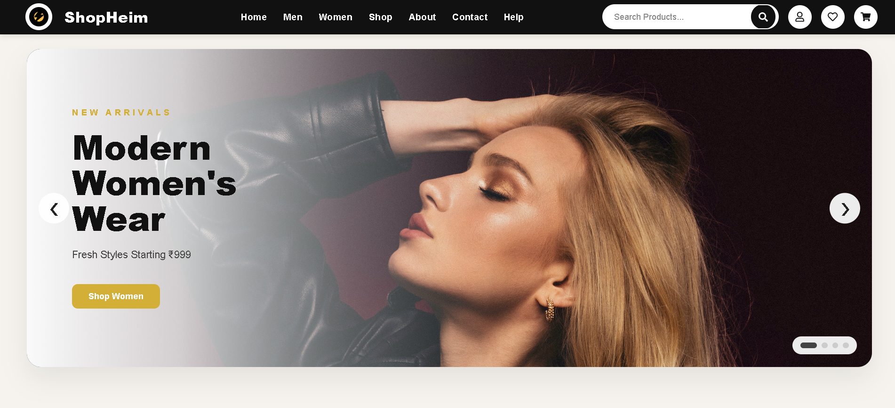

> **Browse curated fashion and sportswear. Filter by category, brand, and price. Manage wishlists and real-time shopping carts.**  
> A modern, responsive full-stack e-commerce web application built with the MERN stack.

[🚀 Live Demo](https://shopheim.vercel.app) · [📖 API Docs](#api-endpoints) · [🐛 Report Bug](https://github.com/JPSOMRAN/shopheim/issues) · [✨ Request Feature](https://github.com/JPSOMRAN/shopheim/issues)

---

## 📑 Table of Contents

- [🌍 Overview](#-overview)
- [📸 Screenshots](#-screenshots)
- [✨ Features](#-features)
- [🛠️ Tech Stack](#️-tech-stack)
- [📁 Project Structure](#-project-structure)
- [🚀 Getting Started](#-getting-started)
- [🔑 Environment Variables](#-environment-variables)
- [📡 API Endpoints](#-api-endpoints)

---

## 🌍 Overview

**ShopHeim** is a full-stack e-commerce storefront designed for seamless browsing across Men's, Women's, Kids', Ethnic, and Sports apparel collections. It combines a fast, responsive storefront with persistent cart and wishlist management, multi-criteria filtering, and secure JWT-based customer authentication.

---

## 📸 Screenshots

### 🏠 Landing Page & Storefront Sections

| Hero Landing Banner | Shop By Category |
| :---: | :---: |
|  | 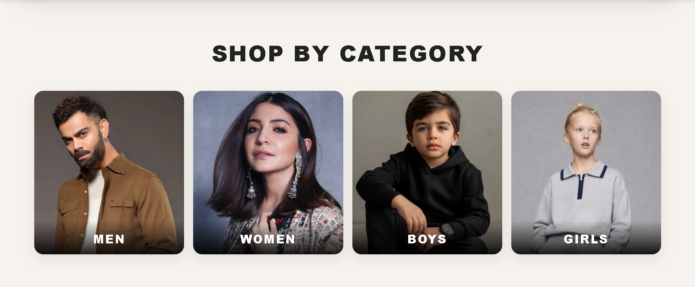 |

| New Arrivals | Trending Collections |
| :---: | :---: |
| 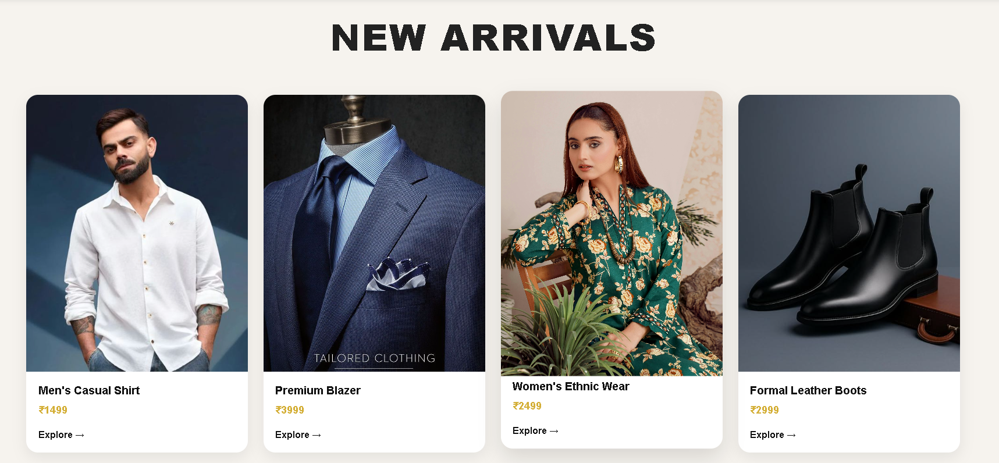 |  |

| Featured Brands | Why ShopHeim & Offers |
| :---: | :---: |
| 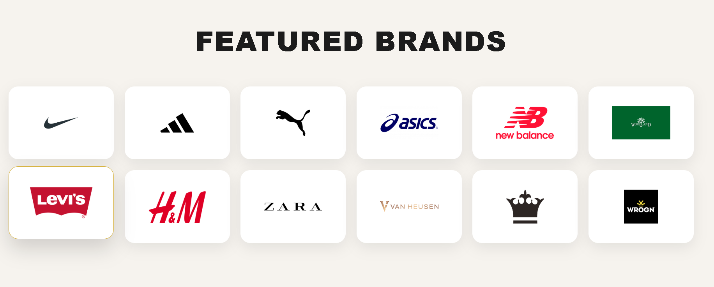 | 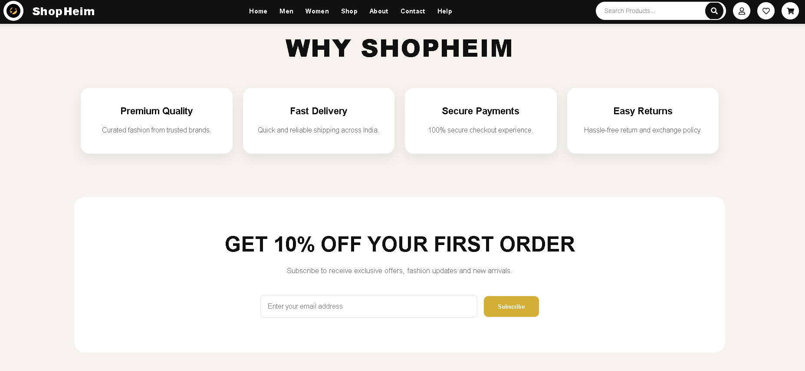 |

### 👕 Product Catalogs & Responsive Views

| Ethnic Wear Catalog | Sports & Jerseys Catalog |
| :---: | :---: |
| 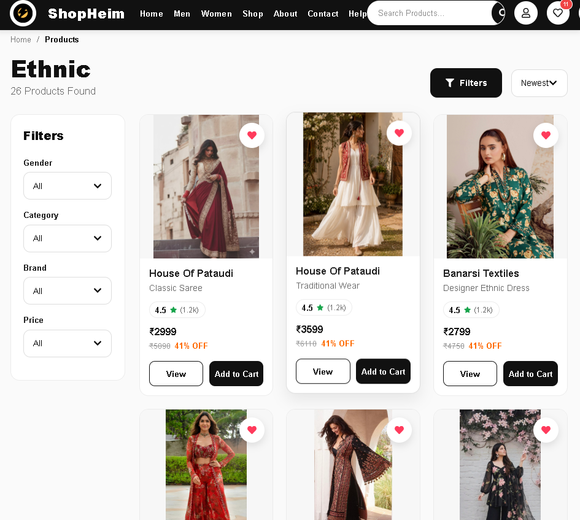 | 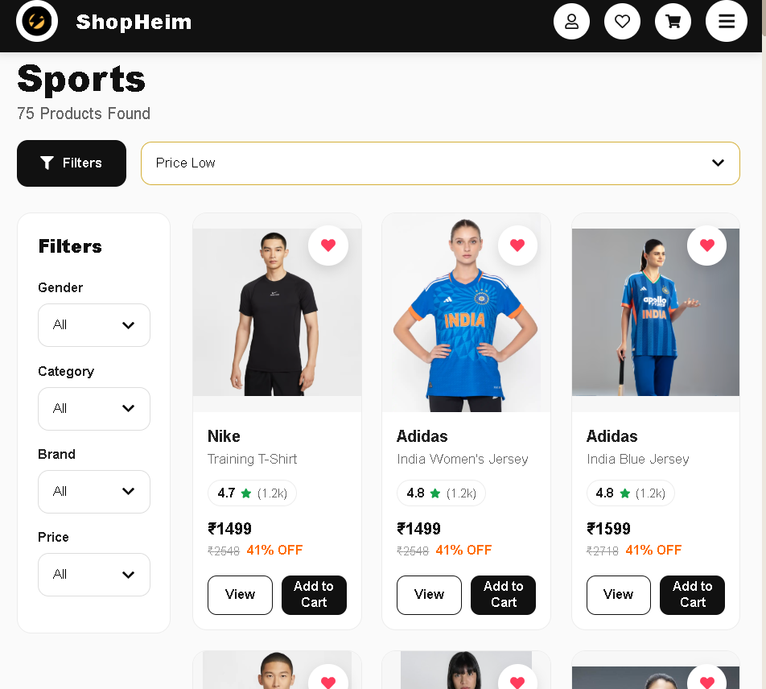 |

| Mobile Responsive Grid | Customer Login |
| :---: | :---: |
| 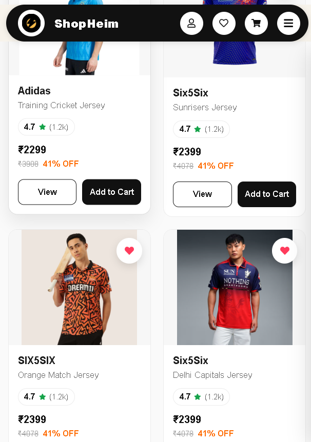 | 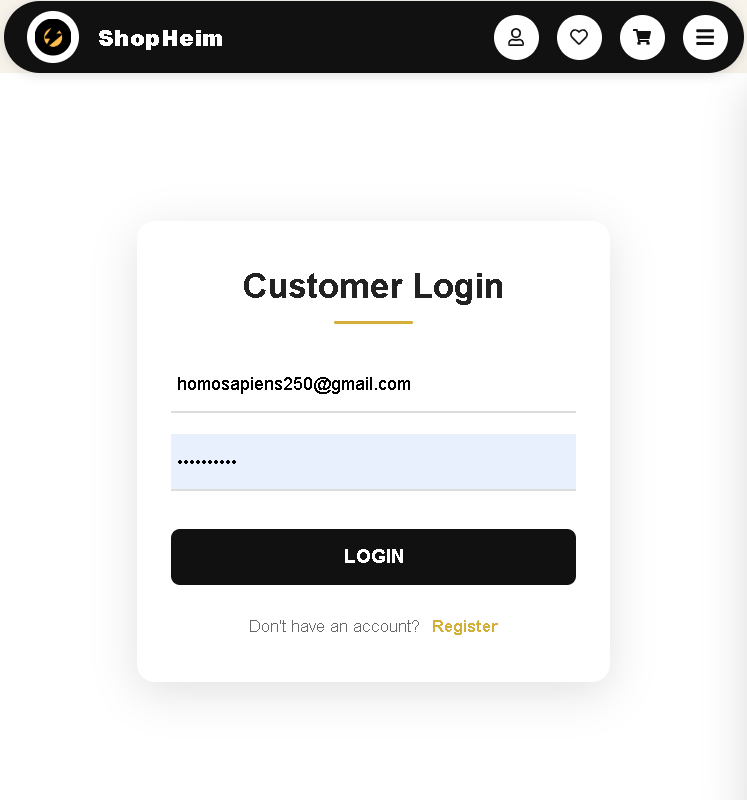 |

### 🔍 Product Detail & Specifications

| Product Detail & Size Selector | Product Highlights & Specs |
| :---: | :---: |
| 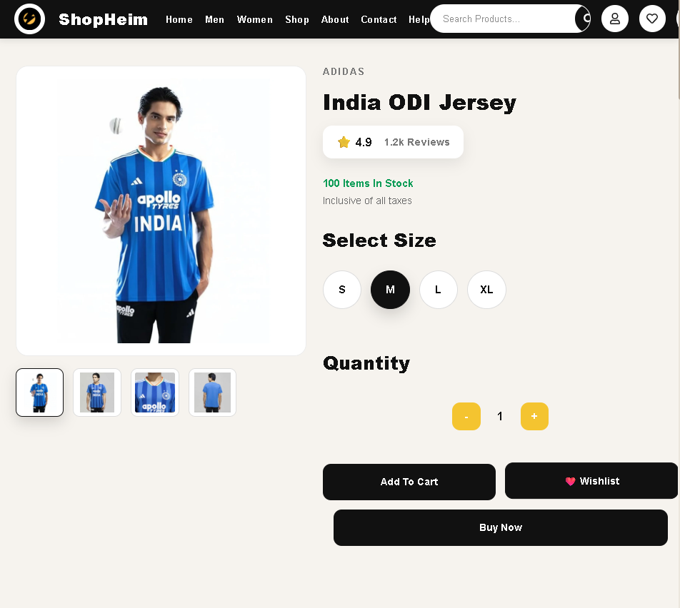 | 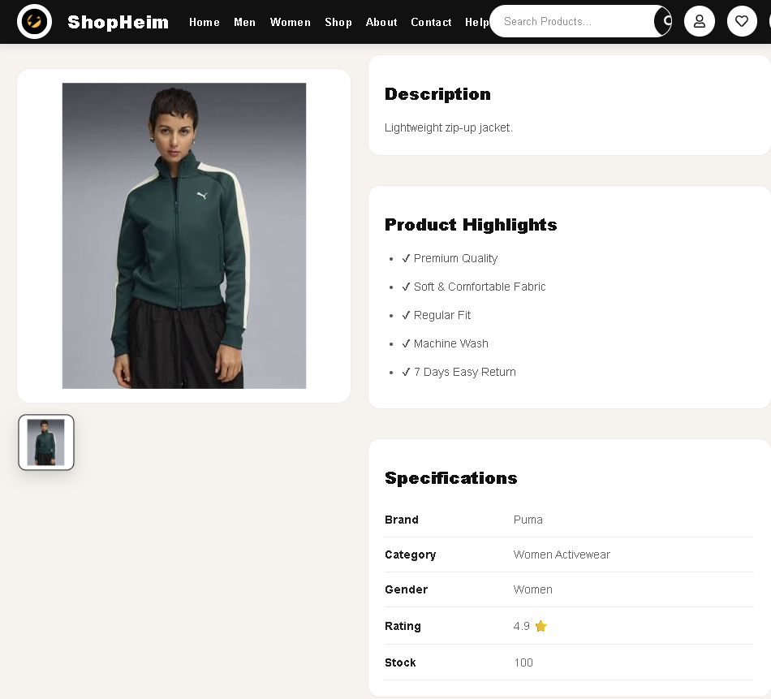 |

### 🛒 Shopping Cart & Wishlist

| Shopping Cart & Order Summary | My Wishlist |
| :---: | :---: |
| 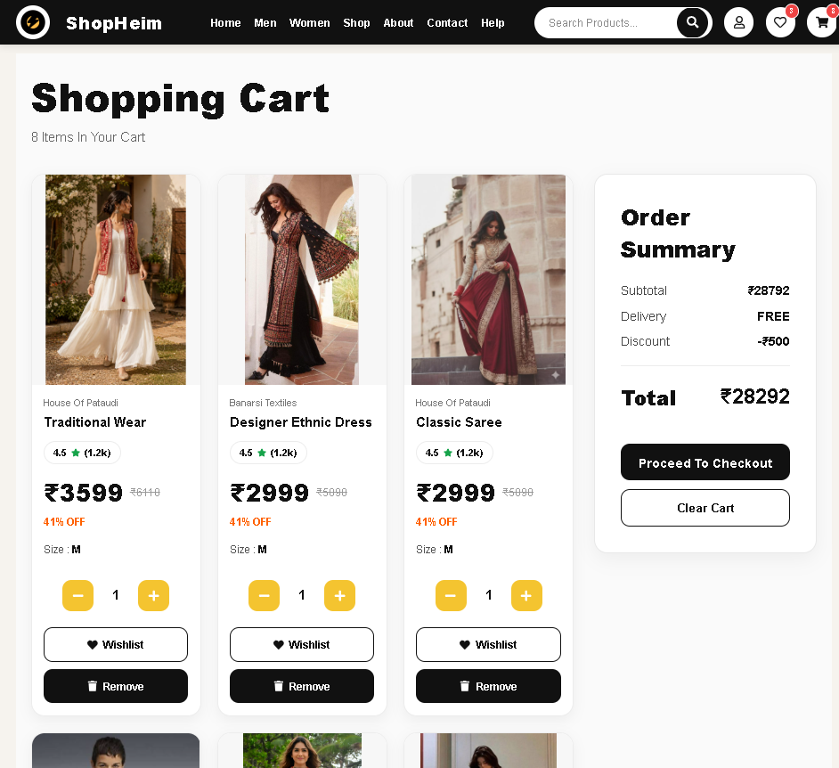 | 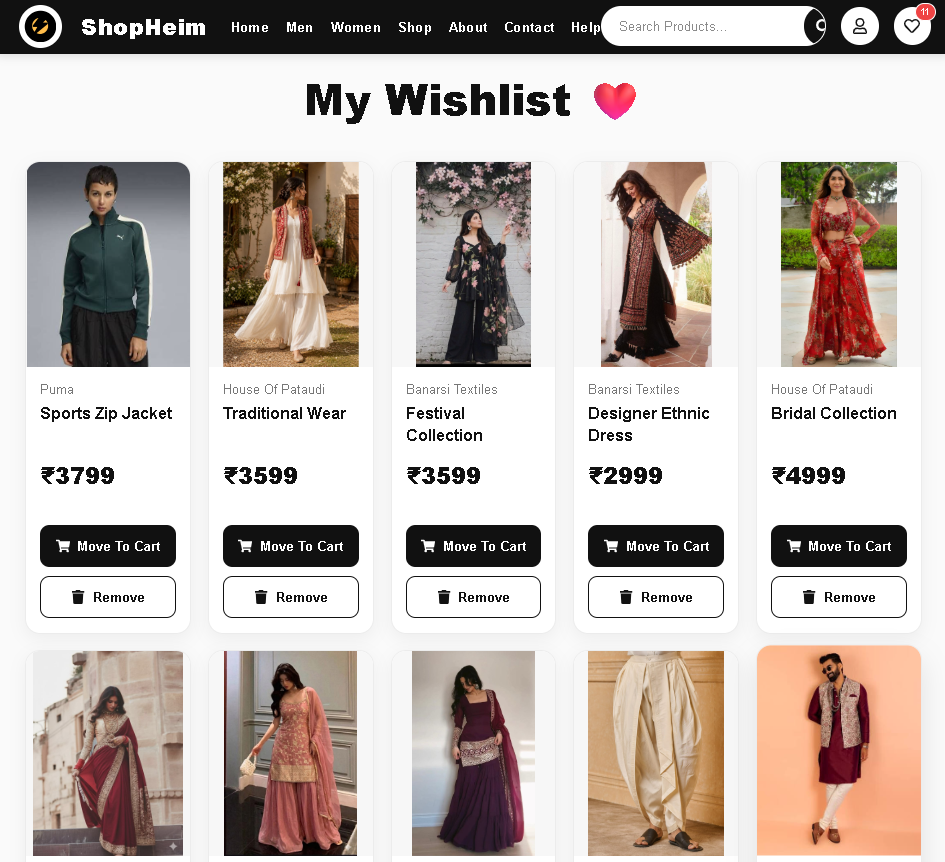 |

---

## ✨ Features

### 🛍️ Storefront & Catalog Discovery
- **Dynamic Hero Carousel** with promotional banners and quick-action CTAs
- **Category Navigation** across `Men`, `Women`, `Boys`, `Girls`, `Ethnic`, and `Sports`
- **Multi-Faceted Filtering & Sorting** by Gender, Category, Brand, Price, and Newest/Price Low-to-High
- **Live Search Bar** in the navigation header for instant product lookup

### 📦 Product Detail View
- Multi-angle thumbnail image gallery
- Interactive **Size Selector** (`S`, `M`, `L`, `XL`) and stock availability badge
- Quantity stepper controls, **Add to Cart**, **Wishlist**, and **Buy Now** actions
- Structured **Product Highlights** and **Specifications** breakdown

### 🛒 Cart & Wishlist Management
- **Persistent Shopping Cart** with live item count badges in the navbar
- Real-time **Order Summary** calculating Subtotal, Free Delivery, Discount, and Final Total
- One-click **Move to Cart** and item removal from **My Wishlist**

### 🔐 Authentication & Security
- **JWT-based** user login and registration flow
- Secure password hashing with **bcryptjs**
- Protected user routes for Cart, Wishlist, and Checkout

---

## 🛠️ Tech Stack

### Frontend
| Technology | Purpose |
| :--- | :--- |
| **React** | Component-based UI architecture |
| **Tailwind CSS** | Responsive utility-first styling |
| **React Router** | Client-side routing across storefront pages |
| **Axios** | REST API integration with auth headers |

### Backend
| Technology | Purpose |
| :--- | :--- |
| **Node.js & Express.js** | RESTful API server |
| **MongoDB & Mongoose** | Product catalog, user, cart & wishlist persistence |
| **JSON Web Token (JWT)** | Stateless session authentication |
| **bcryptjs** | Password encryption |

---

## 📁 Project Structure

```text
shopheim/
├── Frontend/               # React frontend
│   └── src/
│       ├── components/     # Navbar, ProductCard, Filters, CartSummary
│       ├── pages/          # Home, Products, ProductDetail, Cart, Wishlist, Login
│       └── context/        # Auth, Cart & Wishlist state
├── Backend/                # Node.js + Express backend
│   ├── models/             # User, Product, Cart schemas
│   ├── routes/             # Auth, Products, Cart & Wishlist endpoints
│   └── middleware/         # JWT verification guard
└── README.md
